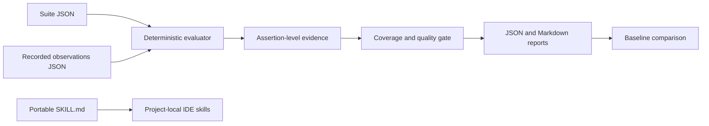

# Starter architecture

The CLI uses only Node.js standard modules. It reads suites and recorded results from disk and does not call an LLM, execute an agent, contact a server, or modify the user's IDE configuration unless explicitly given `install`. The live-runner interface, sandbox, plugin adapters, server API, statistics and provenance hashing are targets for future implementation and documented in the master prompt.

## Evidence limitations
Imported observations may be inaccurate or adversarial. The starter verifies assertions **against imported data** only; it cannot independently authenticate the underlying trace. For production, require attestation, read-only artifact stores and controlled runners.
