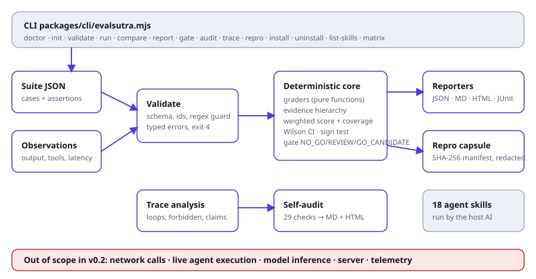

# 3. Architecture

## Context (C4 level 1)

| Actor | Interaction |
|---|---|
| Developer or CI job | runs `evalsutra` with a suite and observations, reads reports and exit code |
| AI IDE (Claude Code, Cursor, Codex, Gemini CLI, Copilot) | loads installed `SKILL.md` files and uses its own AI to follow them |
| Target agent | **not touched.** It produces observations elsewhere |
| Filesystem | the only external system EvalSutra reads and writes |

There is no network, database, queue, server or model call.

## Containers and components (C4 levels 2 and 3)

| Component | Path | Responsibility |
|---|---|---|
| CLI | `packages/cli/evalsutra.mjs` | argument parsing, exit codes, file I/O |
| Installer | `packages/cli/install.mjs` | skill copy, lock file, traversal and symlink guard |
| Evaluator | `packages/core/evaluate.mjs` | suite validation, assertions, scoring, gate, comparison |
| Statistics | `packages/core/stats.mjs` | Wilson interval, pass@k |
| Security helpers | `packages/core/security.mjs` | secret redaction, stable JSON, SHA-256 digests |
| Trace analyser | `packages/core/trace.mjs` | tool trace findings |
| Repro capsule | `packages/core/capsule.mjs` | export and verify |
| Reporters | `packages/reporters/` | HTML, JUnit; `theme.mjs` is the shared design system |
| Self-audit | `packages/audit/audit.mjs` | 29 checks, MD and HTML audit report |
| Skills | `.agents/skills/`, `skills/` | 18 instruction files, canonical and plugin copy |
| Doc and evidence builders | `scripts/build-docs.mjs`, `scripts/build-evidence.mjs` | this documentation and its proof |

## Data flow

1. CLI reads suite and observations (`readJson`, errors become exit code 1 or 4).
2. `validateSuite` rejects bad ids, unknown assertion types, unsafe regex, bad weights, bad thresholds.
3. For each case and assertion, a **pure function** returns `{status, reason, detail}`. No assertion can run code from the fixture.
4. Weak evidence sources downgrade passes to inconclusive.
5. Weights give pass rate and coverage; counts give the gate.
6. Digests of suite and observations, tool and Node versions go into `provenance`.
7. Reporters render JSON, Markdown, HTML, JUnit.
8. `compare`, `gate`, `repro` and `audit` consume the JSON report.

## Key design decisions (ADRs)

| ID | Decision | Reason | Trade-off |
|---|---|---|---|
| ADR-1 | Plain JavaScript ES modules, no build step | `npx` and clone both run immediately; nothing to compile or break | no static types; covered by tests instead |
| ADR-2 | Zero dependencies | no supply-chain risk, tiny audit surface | some code (Markdown converter, Wilson) written in-house |
| ADR-3 | Missing evidence is inconclusive | prevents score inflation | more REVIEW results until evidence is complete |
| ADR-4 | Model judges cannot prove a pass | judge output is an opinion | LLM-graded rubrics cannot gate alone |
| ADR-5 | Replay runner only | live execution needs sandbox and consent design | users must record observations elsewhere |
| ADR-6 | Regex is length-capped and screened, not RE2 | no native dependency | heuristic; upgrade if untrusted suites become common (marked `shortcut:` in code) |
| ADR-7 | Capsule is hashed, not signed | signing needs key management | detects accidents, not forgers |
| ADR-8 | Reports contain no script | safe to open anywhere | no interactive charts yet |

## Failure modes

| Failure | Behaviour |
|---|---|
| Unreadable or invalid JSON | exit 1 with the file path and parser message |
| Invalid suite | exit 4 listing every error |
| Missing observation or field | inconclusive with reason code |
| Unsafe regex | `error` status, never executed |
| Output folder not writable | exit 1 |
| Install target outside project | refused, exit 1 |
| Modified skill at uninstall | kept and reported |

## Extension points

Add an assertion type in `evaluate.mjs` (validate, evaluate, test, audit row). Add a reporter in `packages/reporters/`. Add a skill folder under `.agents/skills/` and run the sync (see [Contributor handbook](12-contributor-handbook.md)). Planned adapters (OpenTelemetry, Promptfoo, Inspect AI, Harbor, MCP Inspector) are described in [Roadmap and status](13-roadmap-and-status.md) and are **not implemented**.

## Deployment topology

A single Node process on the user's machine or CI runner. Distribution: npm (`npx evalsutra`) and GitHub source (`npx github:shahvatsalofficial/evalsutra`). Nothing is hosted.

## Observability

Output is the report. Exit codes are the machine interface. There is no telemetry.
